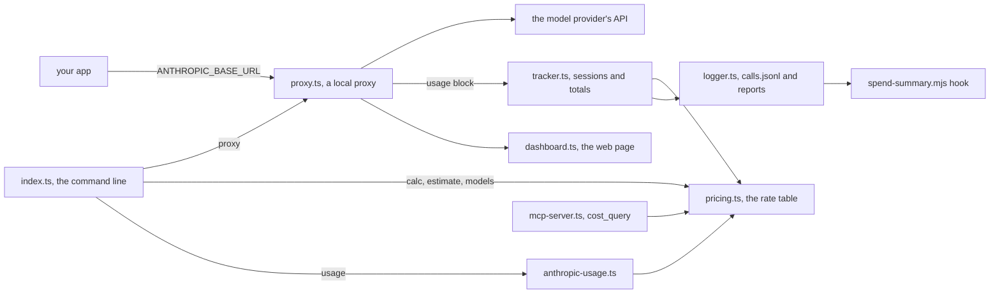

# How AgentMoney works

AgentMoney tells you what your AI calls cost. It prices a call or a session from a built-in rate table for Claude, GPT and Gemini models. Its proxy sits between your app and the model API, prices each reply that reports its token use, and serves a live dashboard. It can also read the usage Anthropic recorded for your organization. It is for developers and coding agents who want to know where the money goes.

## The parts

Everything prices through [src/pricing.ts](../src/pricing.ts). It holds the rates in US dollars per million tokens. It matches a model name exactly, then by prefix, then by containment, so a date suffix or a `provider/` prefix still works. An unknown model is estimated at $3 in and $15 out. [src/index.ts](../src/index.ts) is the command line. `calc`, `estimate` and `models` are pure math and never touch the network.

The proxy lives in [src/proxy.ts](../src/proxy.ts). It forwards each request and reads the `usage` block of each JSON reply. [src/tracker.ts](../src/tracker.ts) prices the call and keeps the totals by model, provider and session. [src/logger.ts](../src/logger.ts) writes the call log and the daily reports, and [src/dashboard.ts](../src/dashboard.ts) draws the web page. [src/anthropic-usage.ts](../src/anthropic-usage.ts) reads Anthropic's Usage API and prices it with the same engine. [src/mcp-server.ts](../src/mcp-server.ts) is an MCP server with one tool, `cost_query`. MCP (Model Context Protocol) is the standard way coding agents call outside tools. The plugin hook [hooks/spend-summary.mjs](../hooks/spend-summary.mjs) tells an agent what was spent when a session starts. [src/sandbox-runner.ts](../src/sandbox-runner.ts) prices a call log you did not write inside an E2B microVM, a small isolated cloud machine.

## What happens when you run it

1. `agentmoney proxy --port 8999 --alert 5.00` runs the `proxy` command in [src/index.ts](../src/index.ts). It creates a `CostTracker` from [src/tracker.ts](../src/tracker.ts) and starts one session.
2. [src/proxy.ts](../src/proxy.ts) starts an Express web server on that port. You point your app at it with `ANTHROPIC_BASE_URL=http://localhost:8999`.
3. Each request is forwarded to the target, `https://api.anthropic.com` by default, with its headers and body.
4. The proxy reads the whole reply. If it is JSON with a `usage` block, it takes the token counts. A block with `input_tokens` is read as Anthropic's shape, any other as OpenAI's.
5. `recordCall` in [src/tracker.ts](../src/tracker.ts) prices the call with `calculateCost` from [src/pricing.ts](../src/pricing.ts). It adds the call to the session. It prints a warning whenever the session total is over the alert.
6. `logCall` in [src/logger.ts](../src/logger.ts) appends the priced call to `.agentmoney/calls.jsonl`. The reply then goes back to your app with its status and headers.
7. The terminal summary refreshes every 5 seconds. `/dashboard`, `/costs` and `/health` serve the same totals as a web page and as JSON.
8. On Ctrl+C, the proxy prints a summary. It writes the day's report as `.agentmoney/report-<date>.json` and `.agentmoney/report-<date>.md`.

## Extending it

- **A model's rates.** Follow [skills/add-model-pricing/SKILL.md](../skills/add-model-pricing/SKILL.md). Add the rate to `PRICING` in [src/pricing.ts](../src/pricing.ts), a row to the README pricing table, and a case to [test/pricing.test.ts](../test/pricing.test.ts). [eval/surfaces.py](../eval/surfaces.py) fails if a priced model is missing from the README. The sandbox program in [src/sandbox-pricer.ts](../src/sandbox-pricer.ts) is generated from the table, so it needs no change.
- **A command.** Add a `program.command(...)` block in [src/index.ts](../src/index.ts). Document it in [AGENTS.md](../AGENTS.md), [README.md](../README.md) and [llms.txt](../llms.txt). The nightly loop in [scripts/improve.mjs](../scripts/improve.mjs) flags any command those files never mention.
- **An MCP tool.** Add its definition and handler in [src/mcp-server.ts](../src/mcp-server.ts). Name it in the skill that covers its job, or the nightly loop will propose it.
- **A skill.** Add `skills/<name>/SKILL.md` with `name` and `description` front matter. [eval/surfaces.py](../eval/surfaces.py) checks its shape. The current skills are in [skills/](../skills/).
- **An eval.** Add a golden task to [eval/golden.sh](../eval/golden.sh) with its `ok` and `bad` helpers. [eval/stub-usage.mjs](../eval/stub-usage.mjs) stands in for the Usage API. Unit tests go in [test/](../test/).

Then run `pnpm build`, `pnpm test` and `pnpm eval`. CI runs the same checks on every push and pull request, in [.github/workflows/ci.yml](../.github/workflows/ci.yml).

## Questions

**Does it need an API key or cost money?** `calc`, `estimate`, `models`, `demo` and the proxy need no key of their own. The proxy passes on whatever key your app sends. `usage` needs an Anthropic Admin API key in `ANTHROPIC_ADMIN_KEY`. `sandbox-run` needs `E2B_API_KEY`. AgentMoney adds no model calls of its own.

**Does any data leave the machine?** The math commands send nothing. The proxy forwards your app's requests to the target, as your app would without it. `usage` calls Anthropic's Usage API. `sandbox-run` uploads the call log to an E2B sandbox. The dashboard page loads its chart library from the jsDelivr CDN. The call log and reports stay in `.agentmoney/`.

**How does it improve itself?** Its self-improvement contract, [dsip.json](../dsip.json), declares DSIP level L2. Darwin's DSIP checker verifies L2 from the repository itself. The evals gate every push and pull request. A nightly workflow, [.github/workflows/improve.yml](../.github/workflows/improve.yml), runs [scripts/improve.mjs](../scripts/improve.mjs). That script also flags rates older than 90 days and priced models missing from the README. It writes `.agentmoney/proposal.md` and never merges. The workflow then opens one issue labelled `proposal`, or updates the one already open, so a person can review it. A daily workflow, [.github/workflows/cost-watch.yml](../.github/workflows/cost-watch.yml), prices a demo session and fails when it passes a budget.

**How do I run its tests and evals?** Run `pnpm install && pnpm build`, then `pnpm test` for the Vitest unit tests in [test/](../test/). `pnpm eval` runs [eval/run.sh](../eval/run.sh): a check of every surface, then 13 golden tasks against the built command line, MCP server and hook. Each task must pass three rounds in a row. No test or eval calls a real API.

**What does it not do?** It never blocks or pauses a call: the alert only prints a warning. The proxy reads each whole reply before passing it on. A streamed reply therefore arrives all at once and is not priced. The proxy keeps one session for its whole run. `usage` leaves out web search and code execution charges. The rates are only as fresh as the table in [src/pricing.ts](../src/pricing.ts).
